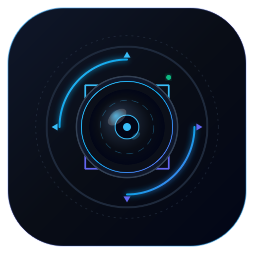

<p align="center">
  
</p>

# PTZControl

A lightweight, always-on-top Windows application to control Pan-Tilt-Zoom (PTZ) cameras and webcams with precision, presets, optical focus, and image adjustments.

---

## Features

- **Compact Floating Toolbar**: Always-on-top compact overlay designed to sit unobtrusively over OBS Studio, vMix, or your streaming setup.
- **Precision Pan / Tilt / Zoom**: Directional D-pad, smooth timer-controlled or step-by-step motor movement, and quick Zoom In/Out.
- **Optical Focus Slider & Auto-Focus (AF)**:
  - Vertical manual focus trackbar placed right on the main floating interface.
  - Dedicated **AF** toggle button to switch between continuous autofocus and manual adjustment on the fly.
- **Image & Color Adjustments**:
  - Sliders for **Brightness**, **Contrast**, and **Saturation** via DirectShow ProcAmp in the Settings dialog.
  - Numeric value readouts and a one-click **Reset Defaults** button.
- **8 Camera Presets per Camera**: Store and recall up to 8 positions per camera with visual active preset indicators (green for current, red for Memory mode). Custom tooltips can be configured per preset.
- **Multi-Camera Switching**: Seamlessly manage up to 3 cameras with dedicated C1, C2, and C3 buttons (dialog dynamically adapts its size when fewer cameras are detected).
- **Broad Camera Compatibility**: Automatically detects Logitech PTZ 2 Pro, PTZ Pro, Rally, Group, and ConferenceCam CC3000e, with fallback discovery for standard DirectShow / USB webcams.
- **Hotkeys & Remote Triggers**: Local and global hotkeys, plus extensive command-line parameters for Bitfocus Companion and Elgato Stream Deck integration.
- **Watchdog Guard Thread**: Detects USB bus or driver freezes and safely terminates to prevent blocking your production workflow.
- **Standalone Portable Binaries**: No installation required; available in x64 and x86.

---

## History

This small program was originally designed to control a Logitech PTZ 2 Pro purchased to stream church services. Operation with the infrared remote control proved cumbersome and inaccurate when the camera was installed high and behind the video technician. The bundled vendor software was inadequate, prompting the creation of a responsive, dedicated control tool. Over time, support was added for multiple cameras (up to three), the Logitech Rally, PTZ Pro, and general DirectShow devices.

---

## Interfaces & Architecture

- **Windows SDK / DirectShow**:
  - `IAMCameraControl` for Pan, Tilt, Zoom, and manual/auto Focus.
  - `IAMVideoProcAmp` for Brightness, Contrast, and Saturation.
- **Logitech CSRK Extension Units**:
  - Hardware preset storage and recall.
  - Native step-by-step Pan/Tilt control via Logitech Lync extension interfaces.
- **Environment**: Native C++ with MFC and ATL (Visual Studio / MSBuild). No external runtime dependencies or installer needed.

---

## Behavior & Controls

### Presets
- **Recall**: Click any number button (`1` to `8`) or press the corresponding hotkey.
- **Store**: Click `M` (Memory button turns red), then click a preset number (`1` to `8`).
- **Home**: Click the center crosshair icon to return the camera to its home position.

### Focus & Image Adjustments
- **Main Floating Toolbar**:
  - Use the vertical slider next to the zoom controls to adjust Focus manually.
  - Click `AF` to toggle auto-focus on or off. Moving the slider automatically switches to manual mode.
- **Settings Dialog**:
  - Sliders for **Focus**, **Brightness**, **Contrast**, and **Saturation** with real-time numeric readouts.
  - Click **Reset Image & Focus** to restore factory default values.

### Camera Switching
- When multiple cameras are connected, buttons `C1`, `C2`, and `C3` appear on the toolbar.
- If only one camera is detected, the dialog automatically shrinks and hides unused camera buttons.

---

## Hotkeys

### Local Hotkeys (When PTZControl Has Focus)
- **Pan / Tilt**: `Left`, `Right`, `Up`, `Down` arrows
- **Home**: `Home`, `NumPad 0`
- **Memory Mode**: `M`
- **Recall Presets 1–8**: `1`–`8` or `NumPad 1`–`8`
- **Zoom In / Out**: `Page Up` / `Page Down`, `NumPad +` / `NumPad -`
- **Settings**: `NumPad /` or `NumPad *`
- **Select Camera 1**: `Alt + 1`, `Alt + NumPad 1`, `Alt + Page Up`
- **Select Camera 2**: `Alt + 2`, `Alt + NumPad 2`, `Alt + Page Down`

### Global Hotkeys (Usable from Any Application)
Global hotkeys use the Windows Key with modifier combinations:
- **Camera 1**:
  - Home: `Win + NumPad 0`
  - Presets 1–8: `Win + NumPad 1` to `NumPad 8`
- **Camera 2**:
  - Home: `Win + Ctrl + NumPad 0`
  - Presets 1–8: `Win + Ctrl + NumPad 1` to `NumPad 8`
- **Camera 3**:
  - Home: `Win + Alt + NumPad 0`
  - Presets 1–8: `Win + Alt + NumPad 1` to `NumPad 8`

---

## Command Line Options

Command-line parameters allow control from external automation tools such as **Bitfocus Companion** or **Elgato Stream Deck**. Commands are routed to the running instance automatically.

### General Options
| Option | Description |
|---|---|
| `-device:"<name>"` | Specify a camera matching a substring of its name. Use `"*"` to accept any camera. |
| `-showdevices` | Display a dialog listing all detected camera devices. |
| `-noreset` | Do not reset the camera to Home or wide-angle zoom on startup. |
| `-noguard` | Disable the watchdog guard thread (useful for debugging). |

### Camera Actions
| Option | Description |
|---|---|
| `-<n>` | Select camera `1`, `2`, or `3`. |
| `-zoom_in` | Zoom camera in. |
| `-zoom_out` | Zoom camera out. |
| `-move_up` | Tilt camera upward. |
| `-move_down` | Tilt camera downward. |
| `-move_left` | Pan camera to the left. |
| `-move_right` | Pan camera to the right. |
| `-n:<n>` | Repeat move or zoom action *n* times (`1 <= n <= 10`). |
| `-move_home` | Move camera to home position. |
| `-store:<n>` | Store current position into preset `1`–`8`. |
| `-restore:<n>` | Restore position from preset `1`–`8`. |

*Execution order if multiple actions are specified:* `Home → Pan → Tilt → Zoom → Restore → Store`.

**Exit codes:** `0` (Success), `8` (Syntax error), `16` (Command execution failure).

---

## Registry Settings

All configurations are stored under:
```text
HKEY_CURRENT_USER\SOFTWARE\MRi-Software\PTZControl
```
- **Options\NoReset**: `1` to keep camera position on startup, `0` to reset to home (default).
- **Options\NoGuard**: `1` to disable the USB guard watchdog thread, `0` to keep active (default).
- **Window**: Stores screen coordinates (`PosX`, `PosY`) and custom preset tooltip labels.
- **Device**: Stores last manual focus and camera adjustment values.
