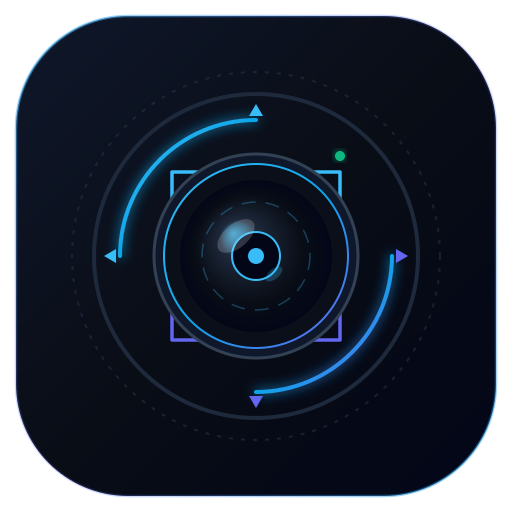
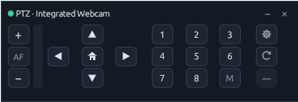

<p align="center">
  
</p>

# PTZControl

A lightweight, high-performance, always-on-top Windows application to control Pan-Tilt-Zoom (PTZ) cameras and webcams with precision, presets, optical focus, and image adjustments.

Written in pure **Rust** (`RustControl/`), with the classic **C++/MFC** implementation preserved (`PTZControl/`).

---

## 📸 Screenshots

| Modern Compact Overlay (Floating Toolbar) |
|:---:|
|  |

| Settings Dialog (Image, Presets, Customizable Hotkeys, Axis Inversion) |
|:---:|
|  |

---

## Features

- **Compact Floating Toolbar**: Ultra-compact, always-on-top floating overlay designed to sit unobtrusively over OBS Studio, vMix, or your streaming desktop.
- **Vector-Rendered D-Pad & Controls**: Crisp geometric icons and buttons rendered at any DPI scaling with zero clipping.
- **Precision Pan / Tilt / Zoom**: Directional controls with timer-based or hardware-step motor movements and smooth Zoom In/Out.
- **Optical Focus & Auto-Focus (AF)**:
  - Vertical manual focus slider directly on the floating toolbar.
  - Dedicated one-click **AF** toggle to switch between continuous autofocus and manual adjustment on the fly.
- **Image & Color Adjustments**:
  - DirectShow ProcAmp sliders for **Brightness**, **Contrast**, and **Saturation** in the Settings dialog.
  - Real-time numeric values and one-click **Reset Defaults** button.
- **8 Camera Presets per Camera**: Store and recall up to 8 positions per camera with visual active preset indicators (green for active, red for Memory store mode). Custom tooltips can be configured per preset.
- **Multi-Camera Switching**: Seamlessly manage up to 3 cameras with dedicated C1, C2, and C3 buttons (the interface dynamically adapts its size when fewer cameras are detected).
- **Axis Inversion**: Invert Pan, Tilt, Zoom, or Focus axes individually to accommodate upside-down, inverted, or ceiling-mounted cameras.
- **Broad Camera Compatibility**: Automatically detects Logitech PTZ 2 Pro, PTZ Pro, Rally, Group, and ConferenceCam CC3000e, with fallback discovery for standard DirectShow / USB webcams.
- **Global & Local Hotkeys**:
  - Global keyboard shortcuts intercepted system-wide even when the application is unfocused.
  - Fully customizable shortcuts from the Settings dialog, defaulting to combinations that do not conflict with Windows built-in shortcuts.
- **Command-Line & Automation**: Full CLI interface for integration with **Bitfocus Companion**, **Elgato Stream Deck**, or external scripts with automatic forwarding to running instances.
- **Watchdog Guard Thread**: Detects USB bus or driver stalls and safely exits to prevent hanging your production workflow.
- **Clean JSON Configuration**: Stored cleanly in `%APPDATA%\PTZControl\config.json` instead of registry keys.
- **Standalone Portable Binaries**: No installation required; portable 64-bit Windows executables.

---

## 👥 Credits & Attribution

This project is a modernized Rust rewrite based on the original **[PTZControl](https://github.com/xMRi/PTZControl)** by **[xMRi](https://github.com/xMRi)**.

- **Original Author & Project**: [xMRi/PTZControl](https://github.com/xMRi/PTZControl) (C++ / MFC).
  - Special thanks to xMRi for the foundational architecture, DirectShow COM interfaces, Logitech Extension Unit (CSRK) research, preset system, and single-instance CLI design.
- **Rust Rewrite & Modernization**: [Noah Bruijninckx (DualsFWShield)](https://github.com/DualsFWShield/PTZControl).
  - Complete rewrite in pure Rust with `eframe` / `egui`.
  - Conflict-free, customizable global keyboard shortcuts captured via background Windows hook.
  - Invertible motion axes for ceiling / inverted camera mounts.
  - DPI-resilient compact UI with vector-drawn controls.
  - JSON-based configuration management (`%APPDATA%\PTZControl\config.json`).
  - Automated dual-edition 64-bit releases (Rust + Legacy C++) via GitHub Actions.

---

## Interfaces & Architecture

- **Windows SDK / DirectShow**:
  - `IAMCameraControl` for Pan, Tilt, Zoom, and manual/auto Focus.
  - `IAMVideoProcAmp` for Brightness, Contrast, and Saturation.
- **Logitech CSRK Extension Units**:
  - Hardware preset storage and recall.
  - Native step-by-step Pan/Tilt control via Logitech Lync extension interfaces.
- **Environment**: Modern Rust implementation (`RustControl/`) using `eframe`/`egui` and direct Windows COM/DirectShow bindings via the official `windows` crate. Legacy C++/MFC version is preserved in `PTZControl/`. No external runtime dependencies or installer needed.
- **Customizable Global Hotkeys**: Intercepted system-wide via a hidden message window even when the application is not focused, fully editable in the Settings dialog.
- **Invertible Pan/Tilt/Zoom/Focus Axes**: Easily invert any motion axis for inverted or ceiling-mounted camera rigs.
- **JSON Configuration**: Stored cleanly in `%APPDATA%\PTZControl\config.json`.

---

## Behavior & Controls

### Presets
- **Recall**: Click any number button (`1` to `8`) or press the corresponding hotkey.
- **Store**: Click `M` (Memory button turns red), then click a preset number (`1` to `8`).
- **Home**: Click the center crosshair icon to return the camera to its home position.

### Focus & Image Adjustments
- **Main Floating Toolbar**:
  - Use the vertical slider next to the zoom controls to adjust Focus manually.
  - Click `AF` to toggle auto-focus on or off. Moving the slider automatically switches to manual mode.
- **Settings Dialog**:
  - Sliders for **Focus**, **Brightness**, **Contrast**, and **Saturation** with real-time numeric readouts.
  - Click **Reset Image & Focus** to restore factory default values.

### Camera Switching
- When multiple cameras are connected, buttons `C1`, `C2`, and `C3` appear on the toolbar.
- If only one camera is detected, the dialog automatically shrinks and hides unused camera buttons.

---

## Hotkeys

### Local Hotkeys (When PTZControl Has Focus)
- **Pan / Tilt**: `Left`, `Right`, `Up`, `Down` arrows
- **Home**: `Home`, `NumPad 0`
- **Memory Mode**: `M`
- **Recall Presets 1–8**: `1`–`8` or `NumPad 1`–`8`
- **Zoom In / Out**: `Page Up` / `Page Down`, `NumPad +` / `NumPad -`
- **Settings**: `NumPad /` or `NumPad *`
- **Select Camera 1**: `Alt + 1`, `Alt + NumPad 1`, `Alt + Page Up`
- **Select Camera 2**: `Alt + 2`, `Alt + NumPad 2`, `Alt + Page Down`

### Global Hotkeys (Usable from Any Application)
Global hotkeys use modifier combinations designed to avoid conflicting with Windows shortcut reservations:
- **Camera 1**:
  - Home: `Ctrl + Shift + NumPad 0`
  - Presets 1–8: `Ctrl + Shift + NumPad 1` to `NumPad 8`
- **Camera 2**:
  - Home: `Ctrl + Alt + NumPad 0`
  - Presets 1–8: `Ctrl + Alt + NumPad 1` to `NumPad 8`
- **Camera 3**:
  - Home: `Ctrl + Shift + Alt + NumPad 0`
  - Presets 1–8: `Ctrl + Shift + Alt + NumPad 1` to `NumPad 8`
- **Customizable**: Every global shortcut can be reassigned or cleared in the **Paramètres → Raccourcis** tab.

---

## Command Line Options

Command-line parameters allow control from external automation tools such as **Bitfocus Companion** or **Elgato Stream Deck**. Commands are routed to the running instance automatically.

### General Options
| Option | Description |
|---|---|
| `-device:"<name>"` | Specify a camera matching a substring of its name. Use `"*"` to accept any camera. |
| `-showdevices` | Display a dialog listing all detected camera devices. |
| `-noreset` | Do not reset the camera to Home or wide-angle zoom on startup. |
| `-noguard` | Disable the watchdog guard thread (useful for debugging). |

### Camera Actions
| Option | Description |
|---|---|
| `-<n>` | Select camera `1`, `2`, or `3`. |
| `-zoom_in` | Zoom camera in. |
| `-zoom_out` | Zoom camera out. |
| `-move_up` | Tilt camera upward. |
| `-move_down` | Tilt camera downward. |
| `-move_left` | Pan camera to the left. |
| `-move_right` | Pan camera to the right. |
| `-n:<n>` | Repeat move or zoom action *n* times (`1 <= n <= 10`). |
| `-move_home` | Move camera to home position. |
| `-store:<n>` | Store current position into preset `1`–`8`. |
| `-restore:<n>` | Restore position from preset `1`–`8`. |

*Execution order if multiple actions are specified:* `Home → Pan → Tilt → Zoom → Restore → Store`.

**Exit codes:** `0` (Success), `8` (Syntax error), `16` (Command execution failure).

---

## Configuration & Persistence

In the modern Rust edition, configuration is persisted in a clean, human-readable JSON file:
```text
%APPDATA%\PTZControl\config.json
```
(Can also be overridden with the `PTZCONTROL_CONFIG` environment variable).

It contains:
- **General**: `always_on_top`, `reset_on_start`, guard watchdog, `use_logitech_motion`, `motor_interval_ms`, `device_tokens`.
- **Axes**: `invert_pan`, `invert_tilt`, `invert_zoom`, `invert_focus` for ceiling-mounted or mirrored setups.
- **Presets**: Custom tooltip labels for all 8 presets across up to 3 cameras.
- **Hotkeys**: Full user-customizable bindings for all actions and camera selections.
- **Window**: Remembers and restores window coordinates.

*(The legacy C++ edition used `HKEY_CURRENT_USER\SOFTWARE\MRi-Software\PTZControl`).*

---

## Releases & Downloads

Pre-built standalone 64-bit executables are available on the [Releases](../../releases) page:
- **`PTZControl-rust-x64.exe`**: Modern Rust edition with customizable global hotkeys, vector toolbar UI, and axis inversion.
- **`PTZControl-legacy-x64.exe`**: Classic C++/MFC edition.
- **`PTZControl.zip`**: Archive containing both x64 editions, documentation, and license.

---

## Building from Source

### Rust Edition (RustControl/)
Prerequisites: Rust stable toolchain (`x86_64-pc-windows-msvc`).
```powershell
cd RustControl

# Build 64-bit release binary
cargo build --release
```

### Legacy C++ Edition (PTZControl/)
Built with Visual Studio / MSBuild:
```powershell
msbuild PTZControl/PTZControl.sln /p:Configuration=Release /p:Platform=x64
```

---

## 📜 License

This project is licensed under the **GNU General Public License v3.0** (`GPL-3.0-or-later`).

- Original C++/MFC Application: Copyright (C) **xMRi** ([https://github.com/xMRi/PTZControl](https://github.com/xMRi/PTZControl))
- Rust Rewrite & Modernization: Copyright (C) 2026 **Noah Bruijninckx (DualsFWShield)** ([https://github.com/DualsFWShield/PTZControl](https://github.com/DualsFWShield/PTZControl))

See the [LICENSE](LICENSE) file for the full license terms.
